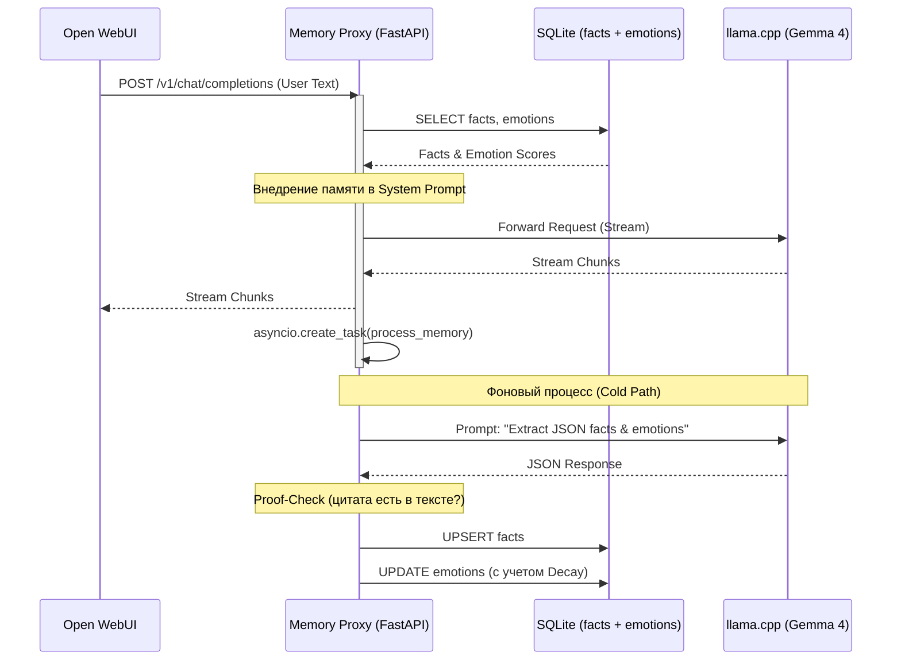

# 🧠 Memory Proxy for Local LLMs

**Умный слой памяти для локальных LLM (llama.cpp / Ollama), совместимый с Open WebUI.**

Прокси-сервер перехватывает запросы в формате OpenAI API, незаметно для пользователя извлекает факты и эмоции в фоновом режиме, и внедряет их в системный промпт. Это дает локальной модели «бесконечную» память и эмоциональный интеллект, не замедляя генерацию ответа.

## 🎯 Функциональные требования (ТЗ)

### Основные функции:
1. **Прозрачный прокси:** Полная совместимость с OpenAI API (эндпоинты `/v1/chat/completions`, `/v1/models`).
2. **Долговременная память:** Асинхронное извлечение фактов о пользователе (город, работа, предпочтения) с помощью LLM.
3. **Эмоциональный интеллект:** Извлечение эмоционального фона к конкретным триггерам (темам/инструментам).
4. **Time Decay (Затухание):** Эмоции имеют свойство «остывать» со временем. Система применяет экспоненциальное затухание (полураспад ~30 дней).
5. **Компрессия контекста:** При переполнении контекстного окна старые сообщения сжимаются, чтобы модель не теряла суть диалога.
6. **Proof-Check (Анти-галлюцинации):** Факты и эмоции принимаются только если LLM приложила дословную цитату из текста пользователя.

### Нефункциональные требования:
* **Zero-Latency (Hot Path):** Ответ пользователю начинает стримиться мгновенно. Извлечение памяти работает в фоне через `asyncio.create_task`.
* **Локальность:** Никаких внешних API (OpenAI, Anthropic). База данных — локальный SQLite.
* **Управление очередью GPU:** Использование `asyncio.Semaphore(1)` для предотвращения конфликтов, если llama.cpp запущен с `--parallel 1`.

---

## 🏗 Архитектура решения



### Компоненты:
* **Hot Path:** Всё, что находится между получением запроса и отправкой его в llama.cpp. Работает <10 мс. Включает в себя сборку промпта из уже готовых данных в БД.
* **Cold Path (Фоновый):** Запускается *после* ответа пользователю. Отправляет текст на анализ модели, проверяет галлюцинации (verbatim match), обновляет SQLite.
* **Математика эмоций:** `new_score = (old_score * exp(-0.023 * days_passed)) + valence`.

---

## 🚀 Руководство по установке

### Предварительные требования:
* Docker и Docker Compose.
* Запущенный сервер `llama.cpp` (в той же Docker-сети или доступный по IP).

### 1. Создание общей сети
```bash
docker network create llm-net
```

### 2. Запуск через Docker Compose
Создайте файл `docker-compose.yml`:

```yaml
version: '3.8'

services:
  memory-proxy:
    image: fastforsage/memory-proxy:v3
    container_name: memory-proxy
    environment:
      - LLAMA_URL=http://gemma4-hauhaucs:8080/v1/chat/completions # URL вашего llama.cpp
      - DB_PATH=/data/memory.db
      - COMPRESS_AT=22000
    volumes:
      - ./data:/data
    ports:
      - "8081:8081"
    networks:
      - llm-net
    restart: unless-stopped

networks:
  llm-net:
    external: true
```

Запустите:
```bash
docker compose up -d
```

### 3. Настройка Open WebUI
1. Зайдите в настройки Open WebUI -> Подключения.
2. Укажите URL: `http://memory-proxy:8081/v1` (если Open WebUI в той же сети) или `http://<IP_хоста>:8081/v1`.
3. Ключ API: любой (например, `sk-no-key-required`).

---

## 📖 Руководство пользователя

После установки прокси работает незаметно. Вам не нужно менять привычки общения.

### Как работает память:
1. **Факты:** Если вы скажете *"Я живу в Питере и работаю в Сбере"*, прокси в фоне извлечет это. В следующем чате модель уже будет знать ваш город и место работы.
2. **Эмоции:** Если вы скажете *"Я обожаю Python, но Jira — это просто кошмар"*, прокси запишет `Python: +1.0`, `Jira: -1.0`. В будущем, когда речь зайдет о Jira, модель будет отвечать более сухо, без лишнего энтузиазма.
3. **Изменение эмоций:** Если через неделю вы скажете *"О, Jira починили, теперь всё супер"*, счет Jira начнет расти в сторону положительного.

### Просмотр базы данных (для администратора):
Проверить, что записалось в память, можно командами:
```bash
# Факты
docker exec -it memory-proxy python -c "import sqlite3; print(sqlite3.connect('/data/memory.db').execute('SELECT predicate, object FROM facts').fetchall())"

# Эмоции (Score, Упоминания)
docker exec -it memory-proxy python -c "import sqlite3; print(sqlite3.connect('/data/memory.db').execute('SELECT trigger, score, mention_count FROM emotions').fetchall())"
```

---

## ⚙️ Описание настроек (Environment Variables)

| Переменная | По умолчанию | Описание |
| :--- | :--- | :--- |
| `LLAMA_URL` | `http://127.0.0.1:8080/v1/chat/completions` | Полный URL до API вашего llama.cpp / Ollama. |
| `DB_PATH` | `/data/memory.db` | Путь к файлу SQLite внутри контейнера. Обязательно маунтить volume. |
| `COMPRESS_AT` | `22000` | Лимит токенов (примерно), после которого срабатывает сжатие старых сообщений. |
| `KEEP_RECENT` | `8` | Сколько последних сообщений оставить нетронутыми при сжатии. |

---

## 🛠 Технологический стек
* **Python 3.11** + **FastAPI** (асинхронный сервер).
* **SQLite** (WAL mode) — надежное и быстрое локальное хранилище.
* **httpx** — асинхронные запросы к llama.cpp.
* **Docker** — изоляция и легкое развертывание.

## 📄 Лицензия
MIT License. Используйте, модифицируйте и распространяйте свободно.

---
*Сделано с любовью к локальным LLM и чистому коду.*
