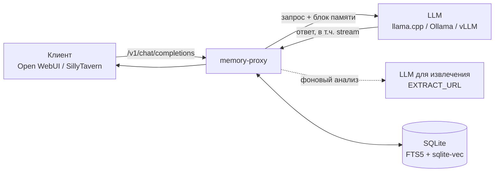

# memory-proxy

Долговременная память для локальных LLM. Прокси с OpenAI-совместимым API встаёт между чат-клиентом (Open WebUI, SillyTavern, LibreChat, curl) и сервером модели (llama.cpp, Ollama, vLLM). Он запоминает факты о пользователе, находит их по смыслу и подставляет в промпт.

Всё работает локально: одна база SQLite, модель эмбеддингов на CPU, без облачных сервисов.

[](LICENSE)
[](https://hub.docker.com/r/fastforsage/memory-proxy)

> **Статус: экспериментальный прототип.** Подходит для личного использования на своей машине. Не предназначен для общего доступа нескольких людей и для выставления в интернет. См. [Ограничения](#ограничения) и [Безопасность](#безопасность).

---

## Содержание
- [Как это работает](#как-это-работает)
- [Быстрый старт](#быстрый-старт)
- [Подключение клиентов](#подключение-клиентов)
- [Подключение бэкендов](#подключение-бэкендов)
- [Конфигурация](#конфигурация)
- [Что запоминается](#что-запоминается)
- [Слэш-команды](#слэш-команды)
- [Безопасность](#безопасность)
- [Данные: просмотр, бэкап, удаление](#данные-просмотр-бэкап-удаление)
- [Обновление](#обновление)
- [Ограничения](#ограничения)
- [Разработка](#разработка)

---

## Как это работает



**Hot path** (на каждый запрос, до обращения к LLM):
1. Берётся последнее сообщение пользователя.
2. Если это текст, а не код, ищутся релевантные факты: полнотекстовый поиск FTS5 (BM25) и векторный поиск sqlite-vec (эмбеддинги [USER2-small](https://huggingface.co/deepvk/USER2-small), 384 измерения). Результаты объединяются через RRF.
3. В **первое** system-сообщение дописывается блок `[ДОЛГОВРЕМЕННАЯ ПАМЯТЬ]`: факты, эмоциональные якоря, примеры стиля и, при необходимости, цитаты из других чатов.
4. Если история длиннее `COMPRESS_AT`, старые сообщения обрезаются (см. [Ограничения](#ограничения)).
5. Запрос уходит в LLM, ответ (в том числе stream) возвращается клиенту как есть и сохраняется в базу.

**Cold path** (фоново, после ответа):
1. Сообщение пользователя отправляется в LLM (`EXTRACT_URL`) с просьбой вернуть JSON с фактами, эмоциями и настроением.
2. Факт сохраняется, только если в ответе есть **дословная цитата** из сообщения (≥ 8 символов) и предикат из белого списка.
3. Для однозначных фактов (`lives_in`, `works_at`, …) старое значение закрывается датой `valid_to`, так что история изменений сохраняется.
4. Для новых фактов считаются эмбеддинги.

Служебные запросы Open WebUI (генерация заголовков, тегов, подсказок) проксируются без изменений и в базу не попадают.

---

## Быстрый старт

### Требования
- Docker и Docker Compose v2
- Работающий OpenAI-совместимый сервер LLM с эндпоинтом `/v1/chat/completions`
- Около 300 MB диска под образ. GPU прокси не нужен.

### 1. Каталог для данных
Контейнер работает от непривилегированного пользователя с **UID 1000**, поэтому каталог данных должен быть доступен ему на запись:
```bash
mkdir -p data && sudo chown 1000:1000 data
```
> Если этого не сделать, Docker создаст `./data` от root, и прокси упадёт при старте с ошибкой `unable to open database file`.

### 2. Файл `.env`
```dotenv
# Куда проксировать запросы (полный путь до /v1/chat/completions)
LLAMA_URL=http://host.docker.internal:8080/v1/chat/completions

# Рекомендуется задать всегда, даже для локального использования (см. «Безопасность»)
MEMORY_PROXY_API_KEY=замените-на-длинную-случайную-строку

# Необязательно: отдельная (меньшая) модель для фонового извлечения фактов
# EXTRACT_URL=http://host.docker.internal:8082/v1/chat/completions
# EXTRACT_MODEL=qwen2.5-3b-instruct
```
Ключ можно сгенерировать так: `openssl rand -hex 32`.

### 3. Запуск
```bash
docker compose up -d
docker compose logs -f memory-proxy   # ждём строку "Ready."
curl http://127.0.0.1:8081/health
# {"status":true,"db":"ok","version":"4.7.4"}
```

Первый старт занимает 15–30 секунд: загружаются модель ONNX и токенизатор.

### Проверка
```bash
curl http://127.0.0.1:8081/v1/chat/completions \
  -H "Authorization: Bearer $MEMORY_PROXY_API_KEY" \
  -H "Content-Type: application/json" \
  -d '{"model":"local","messages":[{"role":"user","content":"Привет! Я живу в Казани и работаю в Яндексе."}]}'
```
Через несколько секунд факты появятся в базе (см. [Данные](#данные-просмотр-бэкап-удаление)).

---

## Подключение клиентов

Прокси отвечает только на три эндпоинта:

| Метод | Путь | Auth | Описание |
|---|---|---|---|
| `GET` | `/health` | нет | Проверка живости и доступа к БД |
| `GET` | `/v1/models` | да* | Проксируется на `LLAMA_URL` с заменой `/chat/completions` на `/models` |
| `POST` | `/v1/chat/completions` | да* | Основной эндпоинт, поддерживает `stream: true` |

\* только если задан `API_KEY`.

`POST /v1/chat/completions` принимает только `Content-Type: application/json` (иначе **415**). Все обычные клиенты так и делают. Запрос, у которого `Host` не входит в `ALLOWED_HOSTS`, получает **400** (см. [Безопасность](#безопасность)).

`/v1/completions`, `/v1/embeddings` и прочие эндпоинты **не проксируются** (404).

### Open WebUI

**1. Сеть.** Если Open WebUI запущен в Docker, проще всего поместить его в одну сеть с прокси. Тогда порт прокси не нужно публиковать наружу.

```yaml
# docker-compose.yml (фрагмент)
services:
  memory-proxy:
    image: fastforsage/memory-proxy:v4.7.4
    container_name: memory-proxy
    restart: unless-stopped
    # ports можно не публиковать, если клиент в той же сети
    environment:
      - LLAMA_URL=${LLAMA_URL}
      - API_KEY=${MEMORY_PROXY_API_KEY:-}
    volumes:
      - ./data:/data
    extra_hosts:
      - "host.docker.internal:host-gateway"

  open-webui:
    image: ghcr.io/open-webui/open-webui:main
    ports:
      - "127.0.0.1:3000:8080"
    environment:
      - ENABLE_FORWARD_USER_INFO_HEADERS=true   # обязательно, см. ниже
    volumes:
      - open-webui:/app/backend/data

volumes:
  open-webui:
```
URL подключения в этом случае: `http://memory-proxy:8081/v1`.

> Имя `memory-proxy` входит в `ALLOWED_HOSTS` по умолчанию. Если сервис или контейнер называется иначе (или вы обращаетесь к прокси по IP), добавьте это имя в `MEMORY_PROXY_ALLOWED_HOSTS`, иначе прокси ответит `400 Invalid host header`.

> ⚠️ **Linux:** стандартный `docker-compose.yml` публикует порт как `127.0.0.1:8081`. Из **другого** контейнера по адресу `host.docker.internal:8081` он недоступен, потому что `host.docker.internal` указывает на bridge-шлюз (`172.17.0.1`), а не на loopback хоста. Используйте общую сеть, как в примере выше. В Docker Desktop (macOS/Windows) `host.docker.internal:8081` работает.

**2. Подключение.** *Admin Panel → Settings → Connections → OpenAI API → +*
- URL: `http://memory-proxy:8081/v1` (или `http://127.0.0.1:8081/v1`, если Open WebUI запущен не в Docker)
- Key: значение `MEMORY_PROXY_API_KEY`, или любая непустая строка, если ключ не задан

**3. Идентификатор чата (важно).** Open WebUI передаёт ID чата в заголовке `X-OpenWebUI-Chat-Id` **только** при `ENABLE_FORWARD_USER_INFO_HEADERS=true`. По умолчанию эта переменная выключена. Без неё все разговоры попадают в один чат `default`, поэтому:
- поиск по другим чатам (Context Bridge) не работает;
- `GLOBAL_MEMORY=0` ничего не изолирует.

### SillyTavern / LibreChat / другие клиенты
Тип подключения — *Chat Completion → Custom (OpenAI-compatible)*, URL `http://127.0.0.1:8081/v1`, ключ — `MEMORY_PROXY_API_KEY`.

Эти клиенты не присылают ID чата. Прокси берёт поле `user` из тела запроса (если оно есть), иначе использует `default`. Факты при этом работают, а разделения на чаты и Context Bridge нет.

---

## Подключение бэкендов

`LLAMA_URL` должен указывать на **полный** путь `…/v1/chat/completions`.

| Бэкенд | `LLAMA_URL` | Примечание |
|---|---|---|
| llama.cpp (`llama-server`) | `http://host.docker.internal:8080/v1/chat/completions` | По умолчанию `llama-server` слушает `127.0.0.1`, а из контейнера этот адрес не виден. Запускайте с `--host 0.0.0.0` (и закройте порт файрволом) или поместите llama.cpp в ту же compose-сеть |
| Ollama | `http://host.docker.internal:11434/v1/chat/completions` | Нужен `OLLAMA_HOST=0.0.0.0`. Имя модели берётся из запроса клиента |
| vLLM | `http://host.docker.internal:8000/v1/chat/completions` | — |
| Сервис в той же compose-сети | `http://llama:8080/v1/chat/completions` | Рекомендуемый вариант |

**Фоновое извлечение фактов** — это дополнительная генерация на каждое сообщение пользователя. Бэкенд должен поддерживать `response_format: {"type": "json_object"}` (llama.cpp, Ollama и vLLM поддерживают).

Если сервер обслуживает один запрос за раз (например, `llama-server` без `--parallel`), извлечение будет конкурировать с ответами. В этом случае лучше поднять отдельную небольшую модель (3–7B вполне достаточно) и указать её в `EXTRACT_URL` / `EXTRACT_MODEL`.

---

## Конфигурация

| Переменная контейнера | В `docker-compose.yml` берётся из | По умолчанию | Описание |
|---|---|---|---|
| `LLAMA_URL` | `LLAMA_URL` | `http://127.0.0.1:8080/v1/chat/completions` | Основной LLM |
| `EXTRACT_URL` | `EXTRACT_URL` | = `LLAMA_URL` | LLM для фонового извлечения фактов |
| `EXTRACT_MODEL` | `EXTRACT_MODEL` | модель из запроса клиента | Значение поля `model` для извлечения |
| `API_KEY` | `MEMORY_PROXY_API_KEY` | пусто (auth выключена) | Bearer-токен для `/v1/*` |
| `CORS_ORIGINS` | `MEMORY_PROXY_CORS_ORIGINS` | пусто (CORS выключен) | Список origin через запятую. Нужен только браузерным клиентам, которые ходят в прокси напрямую. `*` без `API_KEY` запрещён: сервис не стартует |
| `ALLOWED_HOSTS` | `MEMORY_PROXY_ALLOWED_HOSTS` | `localhost,127.0.0.1,host.docker.internal,memory-proxy` | Допустимые значения заголовка `Host` (порт не указывается). Защита от DNS rebinding. Поддерживаются маски вида `*.lan`; `*` отключает проверку (не рекомендуется) |
| `GLOBAL_MEMORY` | `GLOBAL_MEMORY` | `1` | `1` — факты общие для всех чатов; `0` — поиск фактов только в текущем чате (изоляция неполная, см. [Ограничения](#ограничения)) |
| `COMPRESS_AT` | — | `16000` | Порог «токенов» (оценка: символы / 3), после которого старая история обрезается |
| `KEEP_RECENT` | — | `8` | Сколько последних сообщений сохранять при обрезке (минимум 1) |
| `MAX_INPUT_LEN` | — | `200000` | Максимальная длина сообщения пользователя в символах (иначе 400) |
| `MAX_PENDING_COLD` | `MAX_PENDING_COLD` | `32` | Максимум одновременно ожидающих фоновых извлечений. Сверх лимита новые сообщения сохраняются, но не анализируются (в лог пишется предупреждение) |
| `DB_PATH` | — | `/data/memory.db` | Путь к базе SQLite |
| `MODEL_DIR` | — | `/app/model` | Каталог с моделью ONNX и токенизатором (уже в образе) |
| `LOG_LEVEL` | — | `INFO` | `DEBUG` / `INFO` / `WARNING` / `ERROR` |

---

## Что запоминается

### Факты
Извлекаются фоново и только с подтверждающей цитатой: цитата (не короче 8 символов) должна дословно присутствовать в сообщении, а значение факта — в самой цитате (с учётом падежей). Некорректный элемент ответа модели отбрасывается, остальные сохраняются. Разрешённые предикаты:

| Однозначные (новое значение закрывает старое) | Многозначные |
|---|---|
| `works_at`, `lives_in`, `age`, `birthday`, `partner_name`, `current_project` | `likes`, `dislikes`, `knows_language`, `uses_tool`, `has_skill`, `has_pet`, `owns`, `interested_in` |

Старые значения однозначных фактов не удаляются: у них проставляется `valid_to`. Если в вопросе есть «раньше», «прежде», «в прошлом», «помнишь» или «история», в промпт добавляется блок `[ИСТОРИЯ]`.

### Эмоциональные якоря
Темы с выраженным отношением, например «понедельники: −1.0» или «Jira: −1.0». Тема должна встречаться в сообщении (с учётом окончаний: «работа» ↔ «работу»), язык любой. Оценка затухает со временем (период полураспада ~30 дней), поэтому старые эмоции сами уходят из промпта. В промпт попадают как «Позитив: …» / «Негатив: …» (порог |0.5|).

### Context Bridge
Если в сообщении есть «помнишь», «обсуждали», «в другом чате», «в прошлый раз», «мы с тобой» и т. п., в промпт добавляется до 5 цитат пользователя из **других** чатов (FTS5). Цитаты помечаются как данные, а не инструкции. Работает только при корректном ID чата (см. Open WebUI).

### Профиль стиля
Ответы ассистента длиной 80–2000 символов сохраняются как примеры стиля (до 20 на каждый тип: personal / technical). Реакция пользователя на следующий ход меняет оценку: «спасибо», «отлично» → +1; «плохо», «ошибка», «не так», «не работает» → −2, и при оценке ≤ −2 пример удаляется. Критика проверяется первой: «спасибо, но не так» — это −2. В промпт подмешиваются 3 случайных примера с оценкой ≥ 0.

### Что пропускается
- **Сообщения, распознанные как код**: блоки ```` ``` ````, несколько строк, похожих на код (`def`, `import`, `SELECT`, `const` …), или высокая доля символов `{}();=<>` в длинном тексте. Память к ним не подставляется, факты не извлекаются. Смайлики, `!!!`, списки через `-`, ссылки и английский текст кодом не считаются.
- **Сообщения с картинками или файлами** (content в виде массива): проксируются без памяти.
- **Служебные запросы Open WebUI** (генерация заголовков, тегов, подсказок).
- **Повтор того же сообщения** (кнопка «Регенерировать»): сообщение не сохраняется второй раз и повторно не анализируется.

---

## Слэш-команды

Команды обрабатываются самим прокси, в LLM они не уходят. Распознаются только точные команды из списка, сообщения вроде `/etc/hosts …` передаются модели как обычно.

| Команда | Действие |
|---|---|
| `/chats` | Последние 20 чатов с превью |
| `/pull <N>` или `/pull <id>` | Последние 15 сообщений чата: по номеру из `/chats` или по префиксу `chat_id` |
| `/search <запрос>` | Полнотекстовый поиск по вашим сообщениям в **других** чатах |
| `/help` | Справка |

Команда должна занимать всё сообщение. `/pull` и `/search` без аргумента возвращают подсказку по использованию. Сообщения вроде `/help me write a script` или `/chats are great` командами не считаются и уходят в модель. Ответ приходит в том формате, который запросил клиент (`stream: true` → SSE, иначе обычный JSON). Сами команды и их ответы в поиск и `/pull` не попадают.

> Команды показывают сообщения **всех** чатов в базе. Не давайте доступ к прокси людям, которые не должны видеть вашу переписку.

---

## Безопасность

**Модель угроз:** один пользователь на одной машине.

Что сделано по умолчанию:
- Порт публикуется только на `127.0.0.1:8081`.
- CORS выключен: чужая веб-страница не может прочитать ответы прокси.
- **Защита от CSRF:** `POST /v1/chat/completions` принимает только `application/json` (415 для `text/plain` и форм), а запросы браузера с `Sec-Fetch-Site: cross-site` / `same-site` отклоняются (403), если их origin не указан в `CORS_ORIGINS`.
- **Защита от DNS rebinding:** заголовок `Host` проверяется по `ALLOWED_HOSTS` (400 для чужих имён).
- `CORS_ORIGINS=*` без `API_KEY` блокирует старт.
- Ключ сравнивается за постоянное время; некорректный заголовок `Authorization` (в т.ч. не-ASCII) даёт 401.
- Если `API_KEY` не задан, при старте в лог пишется предупреждение.
- Контейнер работает не от root.
- Все SQL-запросы параметризованы.

**Рекомендации:**
1. **Задавайте `API_KEY`, даже локально.** Браузерные атаки (CSRF, DNS rebinding) закрыты встроенными проверками, но без ключа в память может писать и читать её любой локальный процесс или любой контейнер, которому доступен порт.
2. **Не публикуйте порт на `0.0.0.0`** (`docker run -p 8081:8081`, `network_mode: host`) и не выставляйте прокси в интернет. Если удалённый доступ всё же нужен — только через reverse-proxy с HTTPS и ограничением доступа.
3. **Один экземпляр — один человек.** Пользователей прокси не различает: все клиенты с одним ключом пишут в одну память и видят её целиком.
4. **Всё хранится открытым текстом** в `data/memory.db`: все сообщения пользователя, ответы модели и извлечённые факты. Если вы вставляли в чат пароли или ключи, они там тоже есть. Защищайте каталог `data/` и его бэкапы.
5. **Prompt-инъекции.** Текст из прошлых сообщений и чатов попадает в system-промпт. Сообщение вида «игнорируй инструкции…», однажды сохранённое, может всплыть позже в другом чате.

---

## Данные: просмотр, бэкап, удаление

Вся память — это один файл `data/memory.db` (SQLite в режиме WAL, рядом лежат `-wal` и `-shm`).

**Основные таблицы:**

| Таблица | Содержимое |
|---|---|
| `messages` | Сообщения пользователя и ассистента (`chat_id`, `role`, `content`, `ts`, `content_type`) |
| `facts` | Факты с историей (`predicate`, `object`, `evidence`, `valid_from`, `valid_to`, `chat_id`) |
| `vec_facts` | Эмбеддинги актуальных фактов (sqlite-vec, 384 измерения) |
| `facts_fts`, `messages_fts` | Полнотекстовые индексы (обновляются триггерами) |
| `emotions` | Эмоциональные якоря |
| `style_examples` | Примеры стиля с оценкой |

### Просмотр
Удобнее всего скриптом `check_db.py` из репозитория:
```bash
docker exec -i -e DB_PATH=/data/memory.db memory-proxy python - < check_db.py
```
или запросом напрямую:
```bash
docker exec memory-proxy python -c "
import sqlite3; c = sqlite3.connect('/data/memory.db')
for r in c.execute('SELECT id, predicate, object, evidence FROM facts WHERE valid_to IS NULL ORDER BY id'): print(r)"
```

### Бэкап (без остановки)
```bash
docker exec memory-proxy python -c "
import sqlite3; s = sqlite3.connect('/data/memory.db'); d = sqlite3.connect('/data/backup.db'); s.backup(d); d.close()"
# файл появится в ./data/backup.db
```

### Удаление
Команды `/forget` пока нет (запланирована в v4.8), удалять можно вручную. Векторы удаляются вместе с фактом, индексы FTS обновляются триггерами.
```bash
# Удалить один факт по id
docker exec memory-proxy python -c "
import sqlite3, sqlite_vec; c = sqlite3.connect('/data/memory.db'); c.enable_load_extension(True); sqlite_vec.load(c)
fid = 42
with c: c.execute('DELETE FROM vec_facts WHERE rowid=?', (fid,)); c.execute('DELETE FROM facts WHERE id=?', (fid,))"

# Удалить чат целиком
docker exec memory-proxy python -c "
import sqlite3; c = sqlite3.connect('/data/memory.db')
with c: c.execute('DELETE FROM messages WHERE chat_id LIKE ?', ('ab12cd34%',))"
```
Удалить всё: `docker compose down && rm -rf data/* && docker compose up -d`.

---

## Обновление

```bash
docker compose pull && docker compose up -d
```
Схема БД и векторы мигрируют автоматически при старте. Перед обновлением сделайте [бэкап](#бэкап-без-остановки).

### С v4.7.3 и раньше → v4.7.4
Ручных шагов нет. При первом старте прокси сверяет `PRAGMA user_version` и, если база старая, удаляет векторы, построенные без префиксов USER2, пересчитывает их и перестраивает полнотекстовый индекс сообщений. Факты и переписка не трогаются. В логе это выглядит так:
```
Migration: schema v0 → v2, dropped N legacy vectors (will re-embed)
Backfill OK: N
```
`cleanup_vec.py` больше запускать не нужно. Он остался как утилита для принудительного пересчёта: сбрасывает версию схемы, и при следующем старте миграция выполняется заново.

Если клиент обращается к прокси по имени, которого нет в списке по умолчанию (см. `ALLOWED_HOSTS`), добавьте его в `.env`, иначе после обновления запросы будут получать 400.

---

## Ограничения

Это честный список того, что работает не так, как можно ожидать.

- **Нет многопользовательского режима.** `GLOBAL_MEMORY=0` ограничивает только *поиск* фактов текущим чатом. Новое значение однозначного факта в одном чате закрывает факт в другом. Эмоции, примеры стиля, Context Bridge и слэш-команды общие для всех. Полная изоляция по `user_id` запланирована в v4.8.
- **Обрезка, а не суммаризация.** При превышении `COMPRESS_AT` от старых сообщений остаются первые 100 символов последних восьми. Остальное модель не видит (но факты из этих сообщений уже извлечены). Граница окна не разрывает пару `tool_calls` → `tool`, но вырезанные вызовы инструментов модель тоже не видит.
- **Классификатор «код / не код» эвристический.** Короткая одиночная строка кода без ```` ``` ```` может быть принята за обычный текст, а очень «символьный» текст — за код.
- **Prompt-инъекции через память.** Факты и цитаты из других чатов подставляются в system-промпт (с пометкой «это данные»). Перенос в user-сообщение запланирован в v4.8.
- **Эмбеддинги считаются в отдельном потоке**, а запросы к SQLite — в event loop. Рассчитано на одного пользователя и один процесс uvicorn: **не запускайте несколько воркеров**.
- **Таблицы `mood_state` и `summaries`** существуют в схеме, но пока не используются.
- **Производительность не замерялась.** Ориентир: модель эмбеддингов ~138 MB (fp32, CPU). С v4.7.4 в образе нет `transformers` (токенизатор через `tokenizers`).

---

## Разработка

```bash
git clone https://github.com/fastforsage/memory-proxy.git
cd memory-proxy
python3.11 -m venv .venv && . .venv/bin/activate
pip install -r requirements.txt pytest
pytest -q tests/                          # ONNX и токенизатор заменены заглушками, модель не нужна
MP_REAL_MODEL=./model pytest -q tests/    # то же самое с настоящей моделью
```
Тесты: юнит-тесты чистых функций (`tests/test_proxy.py`) и HTTP-тесты через `TestClient` с mock-LLM (`tests/test_api.py`): безопасность, команды, stream / non-stream, фоновое извлечение, миграции.

Локальный запуск без Docker (модель нужно скачать один раз):
```bash
python -c "
from huggingface_hub import snapshot_download
snapshot_download('onnx-community/USER2-small-ONNX', local_dir='model',
    revision='4a3caf0c13a10330815441c2408b7b9447f23744',
    allow_patterns=['onnx/model.onnx','tokenizer.json','tokenizer_config.json','special_tokens_map.json','config.json'])"
MODEL_DIR=./model DB_PATH=./data/memory.db LLAMA_URL=http://127.0.0.1:8080/v1/chat/completions \
  uvicorn proxy:app --host 127.0.0.1 --port 8081
```

Сборка образа:
```bash
docker build -t memory-proxy:dev .
```

### Структура
```
proxy.py             # всё приложение (FastAPI)
download_model.py    # загрузка USER2-small ONNX при сборке образа
check_db.py          # диагностика базы
cleanup_vec.py       # принудительный пересчёт векторов (необязательно)
tests/               # pytest: unit + HTTP-интеграционные
Dockerfile, docker-compose.yml
.github/workflows/   # тесты → сборка + smoke-тест образа → Docker Hub (только по тегу v*)
```

### Roadmap
- **v4.8:**
  - изоляция по `user_id` (сейчас `GLOBAL_MEMORY=0` изолирует не всё);
  - память и цитаты как данные в user-сообщении, а не в system;
  - ограничение FTS-запросов на огромном вводе;
  - `/forget`, `/facts`, `RETENTION_DAYS`;
  - удаление неиспользуемых `mood_state` / `summaries`.
- **Позже:**
  - LLM-суммаризация вместо обрезки;
  - корректная обработка tool calls при сжатии.

Issues и PR приветствуются. К баг-репорту приложите:
- `docker compose logs --tail 100 memory-proxy`;
- запрос, на котором воспроизводится ошибка;
- версию из `curl -s 127.0.0.1:8081/health`.

## Лицензия
[MIT](LICENSE) © fastforsage
