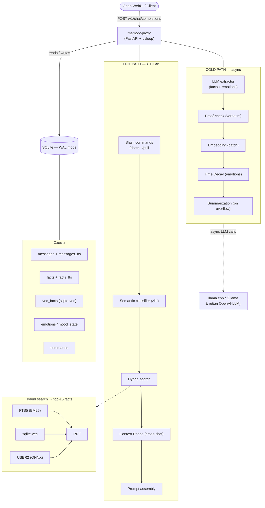

# 🧠 memory-proxy

**Local-first memory layer for LLMs with semantic search, temporal facts, and cross-chat context bridge.**

[](https://hub.docker.com/r/fastforsage/memory-proxy)
[](https://github.com/fastforsage/memory-proxy/releases)
[](#)
[](LICENSE)

`memory-proxy` — это лёгкий FastAPI-прокси между любым OpenAI-совместимым клиентом (Open WebUI, SillyTavern, LibreChat) и локальной LLM (llama.cpp, Ollama, vLLM). Он даёт модели **долговременную память**, **семантический поиск**, **эмоциональные якоря** и **сквозной контекст между чатами** — без облаков, без задержек, без утечек.

---

## ✨ Что внутри (v4.6)

| Слой | Что делает |
| :--- | :--- |
| **Temporal Facts** | История изменений (`works_at`, `lives_in`) с `valid_from` / `valid_to`. Модель знает, что «раньше» ≠ «сейчас». |
| **Semantic Search** | Гибридный поиск: **FTS5 (BM25) + sqlite-vec (KNN) + RRF**. Русскоязычная модель **USER2-small** через **ONNX Runtime** (FP32, bit-identical качество). |
| **Context Bridge** | Сквозной поиск по всем чатам. Auto-триггеры («помнишь», «обсуждали») + слэш-команды `/chats`, `/pull`, `/search`. |
| **Emotional Anchors** | Эмоции к темам (`Jira: -1.0`) с экспоненциальным затуханием (Time Decay). |
| **Mood Engine** | Текущее настроение пользователя (Focus / Irritated / Relaxed) с TTL 30 мин. |
| **Semantic Classifier** | Классификация «код vs личный текст» через **zlib** compression ratio. Технические сообщения не засоряют память. |
| **Proof-Check** | Факт/эмоция принимаются только с дословной цитатой (`evidence`, `quote`). Анти-галлюцинации. |
| **Smart Compression** | LLM-суммаризация контекста при переполнении окна. |

### ⚡ Производительность

| Метрика | Значение |
| :--- | :--- |
| Hot Path overhead | **< 10 мс** |
| Эмбеддинг (CPU) | **~5 мс** (ONNX, ×3 быстрее PyTorch) |
| RAM на инференс | **~50 MB** |
| Размер образа | **~450 MB** (без PyTorch/CUDA) |
| Первый старт | ~10–20 сек (загрузка ONNX) |

---

## 🏗 Архитектура



---

## 🚀 Быстрый старт

### 1. Docker

```bash
docker pull fastforsage/memory-proxy:v4.6
```

### 2. `docker-compose.yml`

```yaml
services:
  memory-proxy:
    image: fastforsage/memory-proxy:v4.6
    container_name: memory-proxy
    environment:
      - LLAMA_URL=http://host.docker.internal:8080/v1/chat/completions
      - DB_PATH=/data/memory.db
      - COMPRESS_AT=22000
      - KEEP_RECENT=8
    volumes:
      - ./data:/data
    ports:
      - "8081:8081"
    restart: unless-stopped
```

### 3. Запуск

```bash
docker compose up -d
curl http://localhost:8081/health
# {"status": true}
```

### 4. Подключение клиента

| Клиент | URL | API Key |
| :--- | :--- | :--- |
| **Open WebUI** | `http://host.docker.internal:8081/v1` | `sk-no-key` |
| **SillyTavern** | `http://localhost:8081/v1` | `sk-no-key` |
| **curl** | `http://localhost:8081/v1/chat/completions` | — |

---

## 🎮 Слэш-команды (Context Bridge)

Пиши прямо в чате клиента:

| Команда | Что делает |
| :--- | :--- |
| `/chats` | Список всех чатов с превью и датой |
| `/pull <N>` | Загрузить последние 15 сообщений из чата №N |
| `/pull <id>` | Загрузить по первым 8 символам `chat_id` |
| `/search <query>` | FTS5-поиск по всем чатам |
| `/help` | Справка |

**Пример:**
```
Ты: /pull 2
Proxy: [ЗАГРУЖЕН КОНТЕКСТ ИЗ ЧАТА a1b2c3d4]
       User: Мы обсуждали FastAPI + JWT...
       You: Да, stateless токены с expiry...

Ты: Напомни, какой JWT-секрет мы использовали?
```

**Auto-триггеры** (не нужно вводить команду):
- «помнишь», «обсуждали», «говорили»
- «в другом чате», «ранее», «в прошлый раз»
- «мы с тобой», «как мы»

Если фраза совпала — прокси сам ищет контекст в других чатах.

---

## ⚙️ Конфигурация

| ENV переменная | Default | Описание |
| :--- | :--- | :--- |
| `LLAMA_URL` | `http://127.0.0.1:8080/v1/chat/completions` | OpenAI-совместимый endpoint LLM |
| `DB_PATH` | `/data/memory.db` | Путь к SQLite (внутри контейнера) |
| `COMPRESS_AT` | `22000` | Порог токенов для суммаризации |
| `KEEP_RECENT` | `8` | Сколько последних сообщений оставить при сжатии |
| `MAX_INPUT_LEN` | `200000` | Жёсткий отсев абсурдно длинных сообщений |

---

## 🗄 Схема БД

```sql
messages      -- все сообщения (chat_id, role, content, content_type)
messages_fts  -- FTS5-индекс по messages (для cross-chat поиска)
facts         -- факты с temporal validity (valid_from, valid_to)
facts_fts     -- FTS5-индекс по facts
vec_facts     -- sqlite-vec эмбеддинги (384-dim, USER2-small)
emotions      -- эмоциональные якоря (trigger, score, decay)
mood_state    -- текущее настроение (TTL 30 мин)
summaries     -- LLM-суммаризации (при overflow)
```

Миграции применяются **автоматически** при старте (`ALTER TABLE IF NOT EXISTS`).

---

## 🧪 Примеры использования

### Память с историей
```
Ты: Я живу в Москве
    → запомнит: lives_in: Москве (valid_from=now)

Ты: Я переехал в Питер
    → инвалидирует: Москве (valid_to=now), добавит: Питере

Ты: Где я жил раньше?
    → модель ответит: «В Москве» (через [ИСТОРИЯ])
```

### Семантический поиск
```
Ты: Я люблю программировать на Python и Rust
    → embedding (USER2-small)

Ты: Что я люблю делать?
    → гибридный поиск (FTS5 + vector) → Python, Rust
    (даже если в запросе нет слова "Python")
```

### Эмоции
```
Ты: Ненавижу Jira, она бесит
    → emotion: Jira = -1.0

Ты: Что ты знаешь о Jira?
    → модель видит: "Негатив: Jira" и отвечает сухо
```

### Mood
```
Ты: Я так устал, всё бесит
    → mood_state: Irritated (0.8)

Ты: Посоветуй, чем заняться вечером
    → ответ мягче, без энтузиазма
```

---

## 🔍 Диагностика

### Проверить факты в БД

```bash
docker exec -it memory-proxy python -c "
import sqlite3
c = sqlite3.connect('/data/memory.db')
print('Активные:', c.execute('SELECT predicate, object FROM facts WHERE valid_to IS NULL').fetchall())
print('История:', c.execute('SELECT predicate, object FROM facts WHERE valid_to IS NOT NULL').fetchall())
"
```

### Проверить векторы

```bash
docker exec -it memory-proxy python -c "
import sqlite3, sqlite_vec
c = sqlite3.connect('/data/memory.db')
c.enable_load_extension(True); sqlite_vec.load(c)
print('Векторов:', c.execute('SELECT COUNT(*) FROM vec_facts').fetchone()[0])
"
```

### Логи в реальном времени

```bash
docker logs -f memory-proxy | grep -E '(Cold|Semantic|Hybrid|ContextBridge|Skip)'
```

**Что означают теги:**
- `[Cold OK]` — успешно извлечены факты/эмоции
- `[Cold Skip]` — пропущено (technical)
- `[Semantic] Batch-embedded N facts` — батчевый эмбеддинг
- `[Hybrid] FTS/Vec` — какой канал поиска сработал
- `[ContextBridge] Auto:` — cross-chat auto-search

---

## 🛠 Сборка из исходников

```bash
git clone https://github.com/fastforsage/memory-proxy.git
cd memory-proxy

# Сборка (ONNX, без PyTorch)
docker build -t fastforsage/memory-proxy:v4.6 .

# Пуш
docker push fastforsage/memory-proxy:v4.6
```

**Структура проекта:**
```
memory-proxy/
├── Dockerfile
├── requirements.txt
├── proxy.py              # FastAPI app
├── download_model.py     # HF snapshot download
├── .dockerignore
└── data/                 # SQLite (volume, не коммитится)
```

---

## 🆚 Сравнение с аналогами

| Проект | Стек | Семантика | Context Bridge | Локальность | Размер |
| :--- | :--- | :--- | :--- | :--- | :--- |
| **memory-proxy** | SQLite + sqlite-vec | ✅ Hybrid (FTS + vec) | ✅ | ✅ Full | **~450 MB** |
| Mem0 | Qdrant + KV | ✅ Vector | ⚠️ Partial | ❌ Cloud-first | > 2 GB |
| Letta (MemGPT) | Postgres + pgvector | ✅ Vector | ⚠️ Per-session | ❌ Server | > 1 GB |
| Zep / Graphiti | Neo4j | ✅ Graph+Vec | ⚠️ Episodes | ❌ Cloud | > 3 GB |

**Чем `memory-proxy` отличается:**
- 🎯 **Single-file SQLite** — вся память в одном `.db`, легко бэкапить
- 🇷🇺 **USER2-small** — специально обученная русскоязычная модель
- 🧬 **Temporal facts** — история изменений (не только «текущее»)
- 🌉 **Context Bridge** — сквозной поиск по чатам из коробки
- ⚡ **~450 MB** — работает на любом CPU без GPU

---

## 📋 Roadmap

- [x] v4.0 — Temporal facts, эмоции, mood
- [x] v4.4 — Context Bridge (cross-chat)
- [x] v4.5 — Semantic search (PyTorch)
- [x] **v4.6 — ONNX Runtime (×3 скорость, ×7 меньше)**
- [ ] v4.7 — Background consolidation (dream phase)
- [ ] v4.8 — Conflict resolution между фактами
- [ ] v5.0 — Мультиязычные эмбеддинги + авто-перевод

---

## 🤝 Contributing

PR welcome. Если нашли баг — создайте issue с:
1. Вывод `docker logs memory-proxy`
2. Запрос, который сломался
3. Версия (`docker inspect memory-proxy | grep Image`)

---

## 📄 License

MIT © [fastforsage](https://github.com/fastforsage)

---
